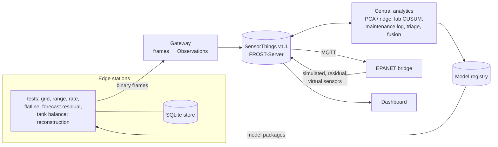
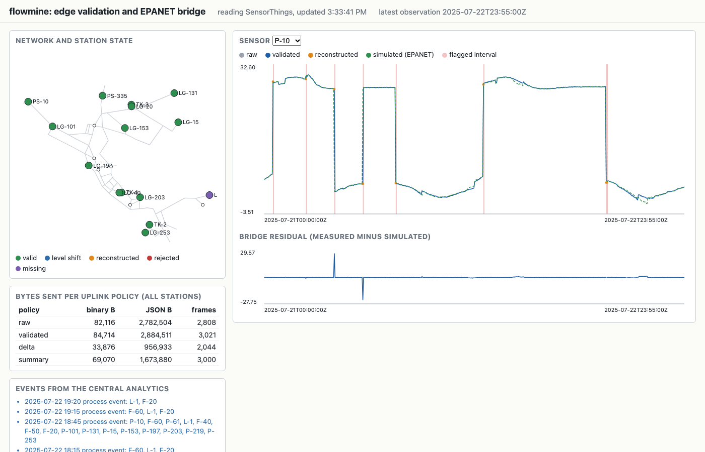
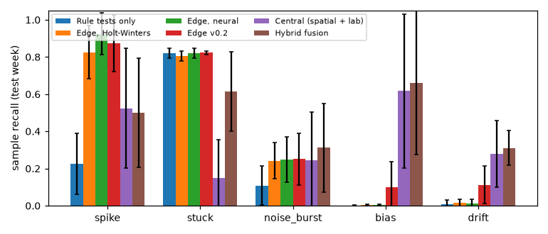
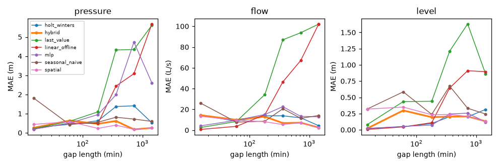
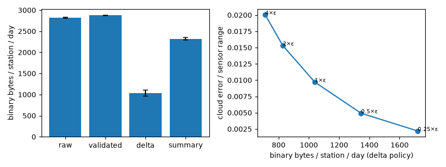

<h1 align="center">flowmine</h1>

Sensor data validation for water distribution networks, split between the sensor
station and the cloud, with a SensorThings data layer and a live EPANET model.

<a href="https://syedtahirhussan.github.io/wds-edge-cloud/"><b>Project page</b></a> ·
<a href="#results">Results</a> ·
<a href="#quickstart">Quickstart</a> ·
<a href="docs/architecture.md">Architecture</a> ·
<a href="docs/limitations.md">Limitations</a>

`flowmine` is a working prototype of edge and cloud data validation for water
distribution systems. It contains:

- MicroPython-compatible validators and forecasters that run at the sensor station;
- a SensorThings API data layer tested against FROST-Server;
- central analytics that combine telecontrol series with laboratory results, a
  maintenance log and weather;
- a bridge that drives an EPANET model from validated observations.

All data are simulated from the EPANET benchmark network Net3. Nothing here has run at
a utility or on a microcontroller: the edge code was tested under the MicroPython
Unix port on a laptop.

I built it to understand the three phases of the i3WaterS DC11 doctoral project
(Distributed and centralized data mining for WDS in the context of IoT and Big data,
UPC) concretely before discussing them with the supervisors.

## Architecture

Details and the reasons for each technology choice are in
[docs/architecture.md](docs/architecture.md).

## The DC11 description, mapped to the code

| DC11 item | modules | experiments |
|---|---|---|
| Phase 1: distributed validation and reconstruction at the edge | `edge/core`, `edge` | E1, E2, E3, E4 |
| Phase 2: analytics on heterogeneous SensorThings data (SCADA, laboratory, maintenance, external) | `sta`, `central` | E1, E2, maintenance and temperature checks |
| Phase 3: integration and synergy of distributed and centralised results | `hybrid`, `experiments` | E1 (fusion), E2 (hybrid), E5, E6, E7 |
| Outcome 1: edge data collection and validation framework | `edge/core`, `edge` | E1-E4 |
| Outcome 2: live IoT data connected to EPANET | `sta`, `twin` | E6, the demo |
| Outcome 3: decentralised storage with centralised model management | `edge/store.py`, `hybrid/registry.py`, `hybrid/federated.py` | E4, E5 |

## Quickstart

Requires Python 3.12 and [uv](https://docs.astral.sh/uv/). The smoke run uses one
seed, two simulated weeks and fewer sensors:

    uv sync --frozen
    make test
    make smoke

To bring up FROST-Server (Docker) and run the contract tests against it:

    make frost-up
    make frost-test

The demo starts the gateway, the dashboard, the live twin, the central analytics and
one process per station, then replays two test days at 1200 times real time:

    make demo        # dashboard at http://127.0.0.1:8050/
    make frost-down

The full experiment set (five seeds) regenerates `results/` and the block below:

    make reproduce

## Results

<!-- results:begin (generated by `flowmine experiments report`; do not edit) -->

Configuration `default`, seeds 1, 2, 3, 4, 5; mean ± sample standard deviation over seeds; test week only unless stated.

- Overall sample F1 (non-gap faults): Hybrid fusion is highest (0.427); the edge-only methods reach 0.153 (Holt-Winters) and 0.153 (neural), the central methods 0.393.
- bias: recall 0.01 at the edge (Holt-Winters) against 0.62 in the cloud; the cloud detects it better.
- drift: recall 0.01 at the edge (Holt-Winters) against 0.28 in the cloud; the cloud detects it better.
- spike: recall 0.82 at the edge (Holt-Winters) against 0.53 in the cloud; the edge detects it better.
- False-alarm rate on clean samples: hybrid 0.0406, edge Holt-Winters 0.0055, central 0.0354.
- v0.2 station against v0.1: F1 0.248 against 0.153, false-alarm rate 0.0151 against 0.0055, bias recall 0.099 against 0.005, drift recall 0.113 against 0.014.
- Conformal residual thresholds (one table per sensor): on clean test-week samples the residual test rejects 0.0065 at nominal 0.01, 0.0037 at nominal 0.005, 0.0007 at nominal 0.001.
- Reconstruction intervals at nominal coverage 0.90 cover 0.85 (Holt-Winters), 0.89 (spatial) and 0.85 (selector by interval width) of test-week gap samples.
- Reconstruction: the calibration week puts the temporal/spatial crossover at 276 ± 277 min. For 1440-min pressure gaps the MAE is 0.499 m (Holt-Winters), 0.281 m (spatial) and 4.930 m (linear interpolation, which needs the future).
- Uplink: delta sends 0.36 of the bytes of the validated policy; SensorThings JSON is 34 times the binary frame size for the same records.
- Cold-start station, one-step RMSE: local 2.220 m, centralised 1.705 m, federated 2.136 m, federated with fine-tuning 2.102 m.
- Twin state error at unmonitored nodes: raw 0.92 m, edge-validated 0.67 m, hybrid 0.64 m, clean 0.47 m.
- Process events: share of event samples reconstructed away central_only 0.016, edge_only 0.010, hybrid 0.011; share of sensor faults raised as events central_only 0.52, edge_only 0.42, hybrid 0.54.

**E1 detection** (overall, non-gap faults)

| method | precision | recall | F1 | event recall | event precision | delay (min) | false-alarm rate | alarms on process events |
|---|---|---|---|---|---|---|---|---|
| Rule tests only | 0.745 ± 0.082 | 0.078 ± 0.008 | 0.142 ± 0.014 | 0.300 ± 0.079 | 0.146 ± 0.047 | 94.308 ± 119.008 | 0.002 ± 0.001 | 0.002 ± 0.001 |
| Edge, Holt-Winters | 0.523 ± 0.041 | 0.090 ± 0.009 | 0.153 ± 0.014 | 0.760 ± 0.065 | 0.107 ± 0.020 | 189.218 ± 84.023 | 0.005 ± 0.001 | 0.008 ± 0.002 |
| Edge, neural | 0.513 ± 0.058 | 0.090 ± 0.010 | 0.153 ± 0.017 | 0.740 ± 0.102 | 0.108 ± 0.024 | 109.134 ± 58.190 | 0.006 ± 0.001 | 0.007 ± 0.002 |
| Edge v0.2 | 0.428 ± 0.061 | 0.181 ± 0.087 | 0.248 ± 0.100 | 0.790 ± 0.089 | 0.099 ± 0.016 | 172.988 ± 69.529 | 0.015 ± 0.005 | 0.025 ± 0.006 |
| Central (spatial + lab) | 0.499 ± 0.231 | 0.367 ± 0.138 | 0.393 ± 0.140 | 0.440 ± 0.195 | 0.129 ± 0.034 | 126.414 ± 219.748 | 0.035 ± 0.039 | 0.067 ± 0.025 |
| Hybrid fusion | 0.470 ± 0.209 | 0.428 ± 0.078 | 0.427 ± 0.103 | 0.650 ± 0.137 | 0.094 ± 0.029 | 197.483 ± 138.301 | 0.041 ± 0.029 | 0.082 ± 0.051 |

**E2 reconstruction**, pressure MAE by gap length

| gap (min) | last_value | linear_offline | seasonal_naive | holt_winters | mlp | spatial | hybrid |
|---|---|---|---|---|---|---|---|
| 15 | 0.222 ± 0.207 | 0.192 ± 0.283 | 1.816 ± 3.445 | 0.261 ± 0.184 | 0.193 ± 0.063 | 0.441 ± 0.285 | 0.261 ± 0.184 |
| 60 | 0.598 ± 0.908 | 0.508 ± 0.949 | 0.434 ± 0.237 | 0.446 ± 0.456 | 0.504 ± 0.277 | 0.582 ± 0.481 | 0.640 ± 0.474 |
| 180 | 1.097 ± 0.625 | 0.491 ± 0.427 | 0.553 ± 0.221 | 0.629 ± 0.401 | 0.952 ± 0.245 | 0.232 ± 0.206 | 0.471 ± 0.469 |
| 360 | 4.323 ± 3.753 | 2.437 ± 1.692 | 0.813 ± 0.979 | 1.372 ± 0.957 | 1.983 ± 1.641 | 0.402 ± 0.301 | 0.618 ± 0.728 |
| 720 | 4.345 ± 2.337 | 3.085 ± 1.331 | 0.718 ± 0.423 | 1.410 ± 0.398 | 4.733 ± 3.077 | 0.179 ± 0.095 | 0.179 ± 0.095 |
| 1440 | 4.867 ± 5.383 | 4.930 ± 5.403 | 0.574 ± 0.282 | 0.499 ± 0.163 | 3.462 ± 4.807 | 0.281 ± 0.227 | 0.281 ± 0.227 |

**E3 uplink**

| policy | binary B/station/day | JSON B/station/day | frames/station/day | frame fill (of 51 B) | latency (min) |
|---|---|---|---|---|---|
| raw | 2820.0 ± 9.6 | 96020.9 ± 392.7 | 95.9 ± 0.3 | 0.6 ± 0.0 | 14.0 ± 2.2 |
| validated | 2878.2 ± 5.9 | 98116.7 ± 101.2 | 102.1 ± 1.0 | 0.6 ± 0.0 | 13.0 ± 2.7 |
| delta | 1039.1 ± 73.3 | 28669.5 ± 2346.3 | 65.6 ± 3.3 | 0.3 ± 0.0 | 5.0 ± 0.0 |
| summary | 2322.3 ± 27.9 | 56197.3 ± 1050.2 | 101.0 ± 0.8 | 0.5 ± 0.0 | 30.0 ± 0.0 |

**E6 twin state estimation**

| input | RMSE monitored (m) | RMSE unmonitored (m) | 95th pct |error| (m) | degraded steps | resyncs |
|---|---|---|---|---|---|
| raw | 1.03 ± 0.46 | 0.92 ± 0.63 | 0.82 ± 0.52 | 0.06 ± 0.06 | 58.00 ± 32.95 |
| edge_validated | 0.86 ± 0.06 | 0.67 ± 0.16 | 0.74 ± 0.34 | 0.00 ± 0.01 | 51.80 ± 39.33 |
| hybrid_validated | 1.12 ± 0.40 | 0.64 ± 0.19 | 0.72 ± 0.22 | 0.00 ± 0.00 | 50.40 ± 45.91 |
| clean | 0.59 ± 0.07 | 0.47 ± 0.14 | 0.37 ± 0.11 | 0.00 ± 0.00 | 36.20 ± 42.10 |

**E7 process events**

| architecture | process events raised | event samples reconstructed | events reconstructed away | faults raised as events |
|---|---|---|---|---|
| edge_only | 0.950 ± 0.112 | 0.010 ± 0.008 | 0.000 ± 0.000 | 0.424 ± 0.100 |
| central_only | 0.500 ± 0.306 | 0.016 ± 0.017 | 0.000 ± 0.000 | 0.518 ± 0.238 |
| hybrid | 0.850 ± 0.137 | 0.011 ± 0.010 | 0.000 ± 0.000 | 0.537 ± 0.215 |

**Edge footprint**

Measured on a laptop (CPython 3.12 and the MicroPython Unix port) for one pressure sensor; these are not ESP32 timings.

| forecaster | parameters | model bytes | buffer (samples) | µs/sample CPython | µs/sample MicroPython |
|---|---|---|---|---|---|
| seasonal_naive | 0 | 8064 | 2028 | 2.7 | 13.2 |
| holt_winters | 4 | 9264 | 2316 | 2.9 | 18.2 |
| mlp | 609 | 2466 | 300 | 27.9 | 118.4 |

All tables, including E4, E5 and the per-fault-type breakdown, are in [results/summary.md](results/summary.md).

<!-- results:end -->

## What the results say

- The station and the cloud see different faults. A station sees one signal. It
  catches spikes and frozen values, catches noise bursts only partly, and is cheap to
  run. It cannot tell a bias step from a pump starting or a leak, so it accepts both
  as level shifts; bias and slow drift pass almost untouched. The cloud catches those
  from the other sensors (bias) and from laboratory samples (chlorine drift, a day or
  two late because of the reporting delay). The spatial model misses most frozen
  values and about half of the spikes.
- Hybrid fusion has the highest overall F1, but its false-alarm rate is several times
  the edge's and varies a lot between seeds. The fusion threshold was set for F1 on
  the calibration week, which favours recall.
- For reconstruction, the station's forecaster is better for short gaps and the
  spatial estimate for long ones. The crossover found on the calibration week varies
  between seeds. Linear interpolation, the offline reference, is good for short gaps
  and poor for long ones.
- Send-on-delta cuts uplink bytes most. The 15-minute summary saves less than
  expected, because every flagged record still goes up individually. Sending
  validated records costs slightly more than sending raw samples, because the gaps go
  up as reconstructions. SensorThings JSON is many times larger than the binary
  frames; the factor is in the block above.
- At unmonitored nodes, validated inputs give the hydraulic model a lower state error
  than raw inputs. The hybrid correction adds little over edge validation and, at the
  monitored nodes, does worse on some seeds. The clean input does not reach zero
  error, because one demand multiplier cannot reproduce how demand is spread over the
  nodes.
- Real process events (the leak, demand surges) are raised by the edge most often,
  because every level shift is reported, and by the central-only design least often.
  None of the three designs reconstructed an event away.

Where the approach loses:

- The triage raises more sensor faults as process events than the edge-only design
  does (E7). A faulty sensor that changes at the same time as a real hydraulic change,
  and that the spatial model does not catch, is counted as part of the event.
- The neural forecaster's recursive forecasts over 12 and 24 hours are worse than
  Holt-Winters', and without the clamp they diverged.
- For the station with three days of history, pooled centralised training gives the
  best one-step error but the worst day-ahead error. Federated averaging moves only
  weights, but the totals depend on the number of rounds.
- Temperature as a covariate changes the day-ahead demand error by less than its
  spread between seeds, even with a perfect weather forecast.
- The maintenance log removes only a small share of the spatial false alarms, because
  operations are short and touch few sensors here.

## Limitations

The full list, and what a utility deployment would need next, is in
[docs/limitations.md](docs/limitations.md). In short:

- simulated data on one small network;
- laptop timings, no ESP32;
- simplified chlorine kinetics;
- a synthetic maintenance log;
- thresholds calibrated with labels of a calibration week;
- one demand multiplier in the twin;
- no security layer on MQTT or HTTP;
- the neural network trained in numpy because PyTorch could not be installed here.

Methods with equations are in [docs/methods.md](docs/methods.md), the SensorThings
mapping in [docs/sensorthings-mapping.md](docs/sensorthings-mapping.md), and the
experimental protocol in [docs/experiments.md](docs/experiments.md).

## References

- [R1] Pérez, R., Puig, V., Pascual, J., Quevedo, J., Landeros, E., Peralta, A. (2011).
  Methodology for leakage isolation using pressure sensitivity analysis in water
  distribution networks. *Control Engineering Practice* 19(10), 1157–1167.
  doi:10.1016/j.conengprac.2011.06.004
- [R2] Pérez, R., Sanz, G., Puig, V., Quevedo, J., Cugueró-Escofet, M. À., Nejjari, F.,
  Meseguer, J., Cembrano, G., Mirats-Tur, J. M., Sarrate, R. (2014). Leak localization
  in water networks: a model-based methodology using pressure sensors applied to a
  real network in Barcelona. *IEEE Control Systems* 34(4), 24–36.
  doi:10.1109/MCS.2014.2320336
- [R3] Sanz, G., Pérez, R., Kapelan, Z., Savic, D. (2016). Leak detection and
  localization through demand components calibration. *Journal of Water Resources
  Planning and Management* 142(2). doi:10.1061/(ASCE)WR.1943-5452.0000592
- [R4] Pérez, R., Martínez-Torrents, A., Martínez, M., Grau, S., Vinardell, L., Tomàs,
  R., Martínez-Lladó, X., Jubany, I. (2022). Chlorine concentration modelling and
  supervision in water distribution systems. *Sensors* 22(15), 5578.
  doi:10.3390/s22155578
- [R5] Quevedo, J., Puig, V., Cembrano, G., Blanch, J., Aguilar, J., Saporta, D.,
  Benito, G., Hedo, M. (2010). Validation and reconstruction of flow meter data in the
  Barcelona water distribution network. *Control Engineering Practice* 18(6), 640–651.
  doi:10.1016/j.conengprac.2010.03.003
- [R6] Cugueró-Escofet, M. À., García, D., Quevedo, J., Puig, V., Espin, S., Roquet, J.
  (2016). A methodology and a software tool for sensor data validation/reconstruction:
  application to the Catalonia regional water network. *Control Engineering Practice*
  49, 159–172. doi:10.1016/j.conengprac.2015.11.005
- [R7] Grau Torrent, S., Pérez Magrané, R., Torret Requena, X., Casado Ruiz, D. (2022).
  Leak localisation method using a detailed hydraulic model combined with high
  resolution pressure sensors applied to a real network. *2nd WDSA/CCWI Joint
  Conference*. doi:10.4995/wdsa-ccwi2022.2022.14560
- [R8] Lloys, M., Guixà, J. L., Dragoste, C., Cots, J., Escobet, T., Grau, S. (2024).
  Development of an integrated system for efficient water resource management using
  ESP32, MicroPython and the IoT. *Engineering Proceedings* 69(1), 170.
  doi:10.3390/engproc2024069170
- [R9] Castro-Gama, M., Hassink-Mulder, Y., Kloosterman, R. (2024). Decision support
  system for critical infrastructure 2050 (BOS model). *Engineering Proceedings*
  69(1), 210. doi:10.3390/engproc2024069210
- [R10] Castro-Gama, M., Hassink-Mulder, Y. (2023). Optimal charging station placement
  for autonomous robots in drinking water networks. *Journal of Hydroinformatics*
  25(6), 2253–2267. doi:10.2166/hydro.2023.040
- [R11] Taylor, J. W. (2003). Short-term electricity demand forecasting using double
  seasonal exponential smoothing. *Journal of the Operational Research Society* 54(8),
  799–805. doi:10.1057/palgrave.jors.2601589
- [R12] McMahan, B., Moore, E., Ramage, D., Hampson, S., Agüera y Arcas, B. (2017).
  Communication-efficient learning of deep networks from decentralized data.
  *Proceedings of AISTATS 2017*, PMLR 54, 1273–1282. arXiv:1602.05629 (no DOI).
- [R13] Kyriakou, M. S., Demetriades, M., Vrachimis, S. G., Eliades, D. G., Polycarpou,
  M. M. (2023). EPyT: an EPANET-Python toolkit for smart water network simulations.
  *Journal of Open Source Software* 8(92), 5947. doi:10.21105/joss.05947
- [R14] Vrachimis, S. G., Eliades, D. G., Taormina, R., Kapelan, Z., Ostfeld, A., Liu,
  S., Kyriakou, M., Pavlou, P., et al. (2022). Battle of the leakage detection and
  isolation methods. *Journal of Water Resources Planning and Management* 148(12).
  doi:10.1061/(ASCE)WR.1943-5452.0001601
- [R15] Klise, K. A., Bynum, M., Moriarty, D., Murray, R. (2017). A software framework
  for assessing the resilience of drinking water systems to disasters with an example
  earthquake case study. *Environmental Modelling & Software* 95, 420–431.
  doi:10.1016/j.envsoft.2017.06.022
- [R16] OGC SensorThings API Part 1: Sensing, Version 1.1. Open Geospatial Consortium,
  document 18-088 (editors S. Liang, T. Khalafbeigi, H. van der Schaaf).
  doi:10.62973/18-088
- LoRa Alliance (2022). LoRaWAN Regional Parameters RP002-1.0.4, section 2.4.6, table
  12 (EU863-870 maximum payload size).
  https://resources.lora-alliance.org/technical-specifications/rp002-1-0-4-regional-parameters
  (no DOI).

R1–R11, R13–R16 were checked on Crossref. R2's author list comes from OpenAlex and
Semantic Scholar because the Crossref record has none. R12 was checked on arXiv and
PMLR, and the LoRaWAN document on the LoRa Alliance site.

## Licence

MIT, copyright Syed Tahir Hussan ([SyedTahirHussan](https://github.com/SyedTahirHussan)).
See [LICENSE](LICENSE).
