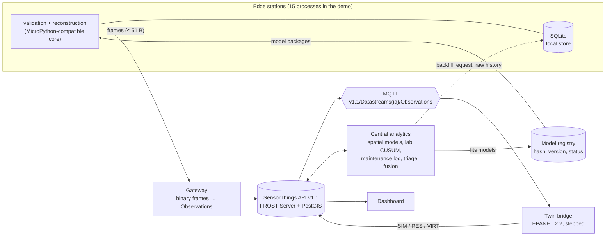

# Architecture

## Components

| component | module | runs as |
|---|---|---|
| edge core | `flowmine.edge.core` | imported by the station; also runs under the MicroPython Unix port |
| station runtime | `flowmine.edge.node`, `edge.store`, `edge.uplink` | `flowmine edge run` |
| gateway | `flowmine.sta.gateway`, `sta.gateway_app` | `flowmine gateway` |
| SensorThings client and provisioning | `flowmine.sta.client`, `sta.provision`, `sta.mqtt` | library |
| fake SensorThings server | `flowmine.sta.fake` | tests |
| central analytics | `flowmine.central` | `flowmine central run` and the experiments |
| twin bridge | `flowmine.twin` | `flowmine twin run --mode replay` or `--mode live` |
| registry, federated training, fusion | `flowmine.hybrid` | library |
| testbed | `flowmine.testbed` | `flowmine testbed build` |
| experiments | `flowmine.experiments` | `flowmine experiments run` and `report` |
| dashboard | `flowmine.dashboard` | `flowmine dashboard` |

## Data flow

1. A station receives a sample, which in this repository is replayed from the
   testbed. It runs the tests and stores the record (raw, validated value, quality
   code, model version) in SQLite, keeping it for 14 days. It then hands the record to
   its uplink policy.
2. Every 15 minutes, or at once after a rejection, the policy packs records into
   frames of at most 51 bytes. Frames wait in the outbox until the link takes them.
3. The gateway knows each station's sensor table and its deployed model version. It
   decodes the frames and posts Observations to SensorThings in JSON batches.
4. FROST-Server stores the Observations and republishes them on MQTT.
5. The twin bridge subscribes over MQTT. It advances the EPANET model one period at a
   time and posts simulated, residual and virtual-sensor streams back.
6. The central analytics reads windows of observations over HTTP and posts events.
   Its fitted models go into the registry. Stations load the active package, check its
   hash, warm it on their stored history and switch to it; the previous version stays
   available for rollback.

## Why each technology

- OGC SensorThings API with FROST-Server. This is the IoT data layer Aigües de
  Manresa is deploying (FOSS4G 2024 talk; CREAF news item, 17 July 2025). It keeps
  sensing metadata (Thing, Sensor, Datastream) next to the data, and its
  `phenomenonTime`/`resultTime` pair represents the laboratory reporting delay
  directly. FROST-Server ships an MQTT broker, so the live twin needs no extra service.
  Image tags are pinned: `fraunhoferiosb/frost-server:2.8.2` and
  `imresamu/postgis:16-3.5`. The latter is a multi-architecture build, because the
  `postgis/postgis` images are amd64 only.
- EPANET 2.2 through WNTR's toolkit wrapper, chosen over EPyT [R13]. The bridge
  needs only the classic stepwise calls (`ENopenH`/`ENinitH`/`ENrunH`/`ENnextH` and
  the quality equivalents, plus `ENsetnodevalue`/`ENsetlinkvalue`). WNTR [R15] is
  already the testbed's simulator and bundles the same EPANET 2.2 library, so the
  reference simulation and the bridge use one engine and one dependency. EPyT would
  add a second wrapper around the same library and its own release cycle. Any `.inp`
  works, including the models Giswater exports from a PostgreSQL network database
  (the route used in [R7]).
- MicroPython-compatible edge core. The low-cost field devices described in [R8]
  are ESP32 boards running MicroPython. The core uses only `math`, `struct`, `array`
  and `json`, keeps fixed-size buffers, and passes its tests under the MicroPython
  1.29 Unix port. Nothing here has run on an ESP32.
- Binary frames. LoRaWAN and NB-IoT uplinks are small and expensive. One reading
  is 12 bytes in a frame and several hundred bytes as SensorThings JSON (E3).
- SQLite at the station. Decentralised storage needs a file that survives restarts
  and can answer "give me sensor X between t0 and t1" for backfill. SQLite is in the
  Python standard library; MicroPython would use a flat ring file instead.
- numpy for training. PyTorch was planned but did not install in this environment
  within the time allowed for it. The network is small enough (609 parameters) that
  manual backpropagation in numpy is short and testable.
